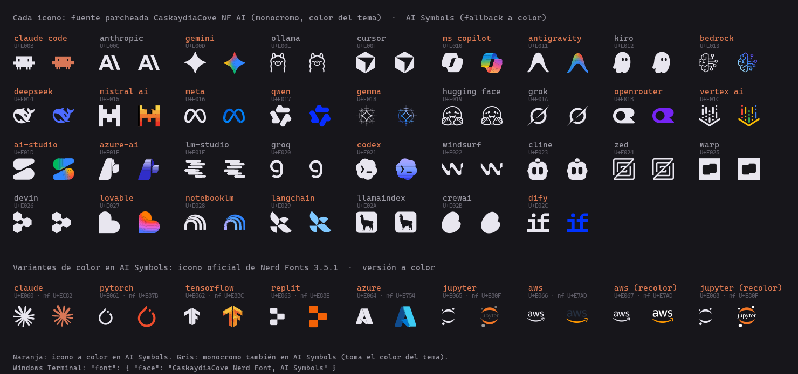
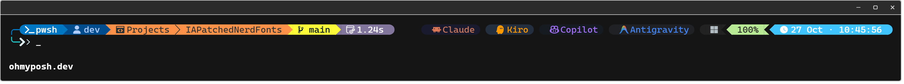

# CaskaydiaCove Nerd Font — AI Icons

<!-- generated:upstream -->

[CaskaydiaCove Nerd Font](https://github.com/ryanoasis/nerd-fonts) **v3.5.1** extended with AI tool icons that Nerd Fonts does not ship yet, taken from [devicons](https://github.com/vorillaz/devicons) **v2.4.0**.

<!-- /generated:upstream -->

Two ways to get them:

- **Patched fonts** (`CaskaydiaCove NF AI`, `NFM AI`, `NFP AI`): the icons are added to the font, monochrome like every Nerd Fonts icon.
- **[AI Symbols](#ai-symbols-color-icons-as-a-fallback-font)**: a small icon-only font that you put after any font in your terminal. Brand logos come in color.



## Included glyphs

<!-- generated:glyphs -->

| Codepoint | Icon | devicons glyph |
|-----------|------|----------------|
| `U+E00B` | Claude Code (robot) | `claude-code` |
| `U+E00C` | Anthropic | `anthropic-icon` |
| `U+E00D` | Google Gemini | `google-gemini-icon` |
| `U+E00E` | Ollama | `ollama-icon` |
| `U+E00F` | Cursor (editor) | `cursor-icon` |
| `U+E010` | Microsoft Copilot | `microsoft-copilot` |
| `U+E011` | Google Antigravity | `google-antigravity-icon` |
| `U+E012` | Kiro | `kiro-icon` |
| **Models and providers** | | |
| `U+E013` | AWS Bedrock | `aws-bedrock-icon` |
| `U+E014` | DeepSeek | `deepseek` |
| `U+E015` | Mistral AI | `mistral-ai-icon` |
| `U+E016` | Meta (Llama) | `meta-icon` |
| `U+E017` | Qwen | `qwen-icon` |
| `U+E018` | Google Gemma | `google-gemma-icon` |
| `U+E019` | Hugging Face | `hugging-face-icon` |
| `U+E01A` | Grok (xAI) | `grok-icon` |
| **Platforms and local inference** | | |
| `U+E01B` | OpenRouter | `openrouter-icon` |
| `U+E01C` | Google Vertex AI | `google-vertex-ai-icon` |
| `U+E01D` | Google AI Studio | `google-ai-studio-icon` |
| `U+E01E` | Azure AI Foundry | `microsoft-azure-ai` |
| `U+E01F` | LM Studio | `lm-studio-icon` |
| `U+E020` | Groq | `groq` |
| **Coding agents and editors** | | |
| `U+E021` | OpenAI Codex | `codex-icon` |
| `U+E022` | Windsurf | `windsurf-icon` |
| `U+E023` | Cline | `cline` |
| `U+E024` | Zed | `zed` |
| `U+E025` | Warp | `warp` |
| `U+E026` | Devin | `devin-icon` |
| `U+E027` | Lovable | `lovable-icon` |
| `U+E028` | NotebookLM | `google-notebooklm-icon` |
| **Frameworks** | | |
| `U+E029` | LangChain | `langchain` |
| `U+E02A` | LlamaIndex | `llamaindex-icon` |
| `U+E02B` | CrewAI | `crewai-icon` |
| `U+E02C` | Dify | `dify-icon` |

<!-- /generated:glyphs -->

### Already in Nerd Fonts — use the official codepoints

Since v3.5.1, Nerd Fonts includes these through Codicons, so this patch does not duplicate them:

| Codepoint | Nerd Fonts name |
|-----------|-----------------|
| `U+EC82` | `nf-cod-claude` |
| `U+EC81` | `nf-cod-openai` |
| `U+EC47` | `nf-cod-mcp` |
| `U+EC1E` | `nf-cod-copilot` (GitHub Copilot) |

### Why `U+E00B`?

Nerd Fonts appends new icons to the end of each icon set's block (Devicons `U+E700…`, Codicons `U+EA60…`), and those blocks grow with every release. `U+E00B–E09F` is the unused gap after Pomicons (`U+E000–E00A`), which has not changed in years, so it is the least likely place to collide with a future Nerd Fonts release. If Nerd Fonts adds any of these icons officially, they will be removed from this patch in favor of the official codepoint.

## Installing

Download the zip from [Releases](../../releases), extract it, select the `.ttf` files, and choose **Install** (or **Install for all users**).

The fonts install as a separate family (`CaskaydiaCove NF AI`, `CaskaydiaCove NFM AI`, `CaskaydiaCove NFP AI`), so they can live side by side with the upstream Nerd Font.

| Variant | Use it when |
|---------|-------------|
| **NFM** (Mono) | Your terminal requires strict monospacing. Icons fit in one cell. |
| **NF** | Most terminals. Icons are larger and overflow to about 1.7 cells, like the official Nerd Fonts icons. |
| **NFP** (Propo) | Proportional contexts: GUI elements and presentations. |

To check the glyphs in your terminal:

<!-- generated:check -->

```powershell
0xE00B..0xE02C | ForEach-Object { "$([char]$_)  U+{0:X4}" -f $_ }
```

<!-- /generated:check -->

In an Oh My Posh theme, use the escape sequence, e.g. `"\ue00b"` for the Claude Code robot.

## AI Symbols: color icons as a fallback font

**AI Symbols** is a small font with *only* these icons, at the same codepoints. Instead of patching your font, you list it after your regular Nerd Font, and the terminal takes the icons from it. Nerd Fonts stays untouched and monochrome; the AI icons come in color.

<!-- generated:symbols -->

| Icon | In AI Symbols |
|------|---------------|
| Claude Code (robot), Google Gemini, Microsoft Copilot, Google Antigravity, AWS Bedrock, DeepSeek, Mistral AI, Meta (Llama), Qwen, Google Gemma, OpenRouter, Google Vertex AI, Google AI Studio, Azure AI Foundry, OpenAI Codex, Lovable, NotebookLM, LangChain, Dify | **Color** (brand colors from the devicons SVGs) |
| Anthropic, Ollama, Cursor (editor), Kiro, Hugging Face, Grok (xAI), LM Studio, Groq, Windsurf, Cline, Zed, Warp, Devin, LlamaIndex, CrewAI | Monochrome: they take your theme's color, like any Nerd Fonts icon. Black logos, or logos whose monochrome outline does not match the color artwork |

<!-- /generated:symbols -->

### Color variants of icons Nerd Fonts already has

AI Symbols also has **color versions** of some icons that Nerd Fonts ships in monochrome. Use the Nerd Fonts codepoint when you want the icon in your theme's color, and the AI Symbols one when you want the brand colors. These are only in AI Symbols, not in the patched fonts.

<!-- generated:variants -->

| Color (AI Symbols) | Monochrome (Nerd Fonts) | Icon |
|--------------------|-------------------------|------|
| `U+E060` | `U+EC82` `nf-cod-claude` | Claude |
| `U+E061` | `U+E87B` `nf-dev-pytorch` | PyTorch |
| `U+E062` | `U+E8BC` `nf-dev-tensorflow` | TensorFlow |
| `U+E063` | `U+E88E` `nf-dev-replit` | Replit |
| `U+E064` | `U+E754` `nf-dev-azure` | Azure |
| `U+E065` | `U+E80F` `nf-dev-jupyter` | Jupyter |
| `U+E066` | `U+E7AD` `nf-dev-aws` | AWS (the dark "aws" lettering is hard to see on dark backgrounds) |

<!-- /generated:variants -->

OpenAI and GitHub Copilot have no color variant: they are black in devicons too.

Two families, like the official *Symbols Nerd Font*:

| Family | Use it with |
|--------|-------------|
| `AI Symbols` | NF fonts: icons are UPM-sized and overflow to about 1.7 cells |
| `AI Symbols Mono` | NFM fonts: icons fit in one cell |

Windows Terminal (`settings.json`, per profile or in `profiles.defaults`):

```json
"font": { "face": "CaskaydiaCove Nerd Font, AI Symbols" }
```

Put it after an **unpatched** Nerd Font (or any font). The patched `… AI` fonts already have monochrome glyphs at these codepoints, and the first font in the list wins.

How the color works:

- The glyph outline is the same one used in the patched fonts, so apps without color font support show the monochrome icon.
- Colors are stored as **COLR v0 + CPAL** layers, the color font format Windows Terminal renders. Windows Terminal ignores COLR v1 gradients, so gradients and blurred meshes (Gemini, Copilot, Antigravity) are approximated with a 32×32 grid of solid-color tiles, each with the average color of that area of the rendered SVG. Each icon is reduced to at most 48 colors, and all tiles of the same color are merged into one layer, so the font stays small (about 130 KB). At terminal sizes each tile is about one pixel. Single-color logos (Claude Code, DeepSeek) are one exact layer.
- Color icons ignore the text color set by your theme.

## Showing the AI tool of a project in your prompt

A common use: show which AI tool a folder is set up for (`.claude/`, `.kiro/`, `.agents/`…).



### Oh My Posh

Use the `glob` template function, which checks the current folder, so no shell setup is needed:

```json
{
  "type": "text",
  "style": "diamond",
  "background": "#1a1a2e",
  "foreground": "#cc785c",
  "leading_diamond": "\ue0b6",
  "trailing_diamond": "\ue0b4",
  "template": "{{ if glob \".claude\" }} \ue00b Claude{{ end }}"
}
```

Combine checks with `or`, e.g. for Antigravity: `{{ if or (glob \".agents\") (glob \".agent\") }}`.

Repeat the segment with `\ue012` for Kiro, `\ue011` for Antigravity, or `\uec1e` (`nf-cod-copilot`) for GitHub Copilot. An empty template hides the segment.

### Starship

Starship detects folders natively with a `custom` module:

```toml
[custom.claude]
detect_folders = [".claude"]
symbol = "\ue00b "
format = "[$symbol]($style)"
style = "#cc785c"

[custom.kiro]
detect_folders = [".kiro"]
symbol = "\ue012 "
format = "[$symbol]($style)"
style = "#ff9900"
```

## Adding an icon

Icons and upstream versions live in [`icons.toml`](icons.toml), the only place to edit. The scripts and the tables in this README read it.

1. Find the glyph name in devicons (`dist/devicons.ttf`).
2. Add an `[[icon]]` with the next free codepoint, which `python icons.py check` prints. Add `color = true` if the brand colors of the SVG should be used in AI Symbols.
3. Run `python icons.py readme` to update the tables, and open a pull request.

`icons.py` rejects repeated codepoints or glyph names, codepoints outside `U+E00B–E09F`, and missing fields.

## CI

| Workflow | When | What it does |
|----------|------|--------------|
| [`build.yml`](.github/workflows/build.yml) | Every push and pull request | Validates `icons.toml` and that the README is up to date, builds both font sets, runs `verify.py`, `verify_symbols.py` and OpenType Sanitizer, and attaches the fonts to the run |
| [`upstream.yml`](.github/workflows/upstream.yml) | Mondays, or by hand | If Nerd Fonts or devicons has a new version, updates `icons.toml`, builds, and opens a pull request. If the build fails, the pull request is a draft |
| [`release.yml`](.github/workflows/release.yml) | Pushing a `v*` tag | Builds and creates a draft release with both zips |

## Building the fonts yourself

Download the versions in `icons.toml`:

<!-- generated:sources -->

```text
CaskaydiaCove Nerd Font v3.5.1  https://github.com/ryanoasis/nerd-fonts/releases/download/v3.5.1/CascadiaCode.tar.xz
devicons v2.4.0                https://registry.npmjs.org/devicons/-/devicons-2.4.0.tgz
```

<!-- /generated:sources -->

```powershell
pip install -r requirements.txt

python patch_all.py <folder-with-ttf> --devicons <devicons\package\dist\devicons.ttf> -o Patched
python verify.py <folder-with-ttf> Patched

python build_symbols.py --devicons-pkg <devicons\package> --reference <folder-with-ttf>\CaskaydiaCoveNerdFont-Regular.ttf -o Symbols
python verify_symbols.py Symbols
```

AI Symbols needs the whole devicons package (`dist/devicons.ttf` and `dist/sprite-symbol.svg`).

`patch_all.py`:

- Scales each icon by the devicons em (like Nerd Fonts' `font-patcher`), so icons keep their relative sizes. Glyphs that overflow the em are shrunk to fit.
- **Mono**: fits the icon in one cell, centered, with a one-cell advance, so the font stays monospaced.
- **NF**: UPM-sized icon, one-cell advance, overflowing to the right like `nf-cod-*`.
- **Propo**: UPM-sized icon, with an advance equal to the icon width.
- Centers icons vertically on `(sTypoAscender + sTypoDescender) / 2`.
- Adds the glyphs to every Unicode `cmap` subtable (formats 4 and 12).
- Renames the family to `… AI` (e.g. `CaskaydiaCove NFM AI SemiBold`, within the 31-character limit older apps use) and the PostScript name to `…AI-Style`, and appends a note to the version string.

- Refuses to patch a font that already has glyphs in `U+E00B–E09F`, for example a font that was already patched, or a future Nerd Fonts release that started using the range.

`build_symbols.py` builds both AI Symbols families with the same geometry as `patch_all.py` (shared `icon_transform`), reading the vertical metrics and cell width from the `--reference` font. `verify_symbols.py` checks codepoints, advances, the cell and vertical boxes, and that every COLR layer exists, stays inside its icon, and uses a valid palette index.

`verify.py` compares each output font with its source and checks codepoints, advances, the cell box, vertical centering, a duplicate-free glyph order, unchanged original metrics, names, and that the Nerd Fonts icons of the color variants still exist. The release fonts also pass [OpenType Sanitizer](https://github.com/khaledhosny/ots-python) (`python -m ots`).

## Licenses

- **Fonts**: SIL Open Font License 1.1 — see [`OFL.txt`](OFL.txt). This applies to Cascadia Code (© Microsoft, Reserved Font Name *Cascadia Code*), to the Nerd Fonts patches, and to these modified versions, which must remain under the OFL.
- **Icons**: from [devicons](https://github.com/vorillaz/devicons) (MIT). The logos are trademarks of their respective owners and are included only to identify those tools.
- **AI Symbols**: built only from devicons glyphs and SVGs (MIT).
- **Scripts** (`icons.py`, `patch_all.py`, `verify.py`, `build_symbols.py`, `verify_symbols.py`): GNU GPL v3 — see [`LICENSE`](LICENSE).
